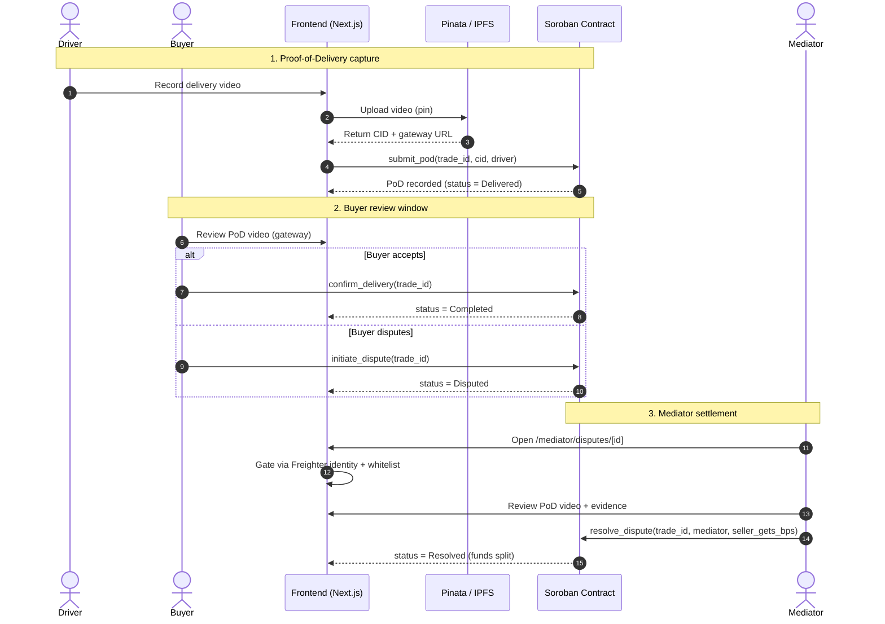
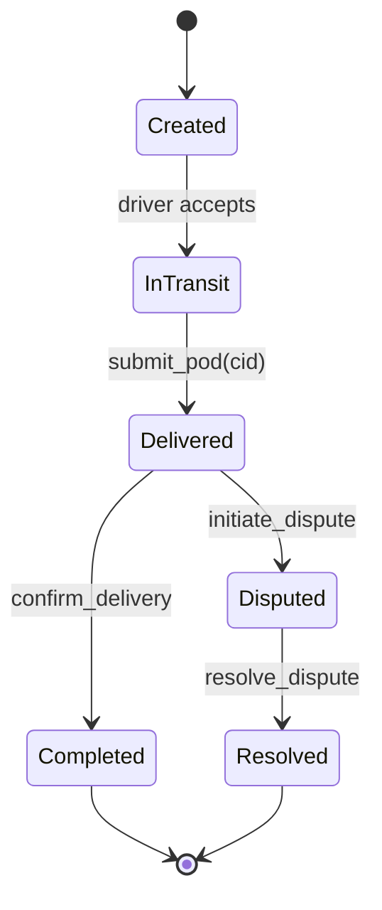
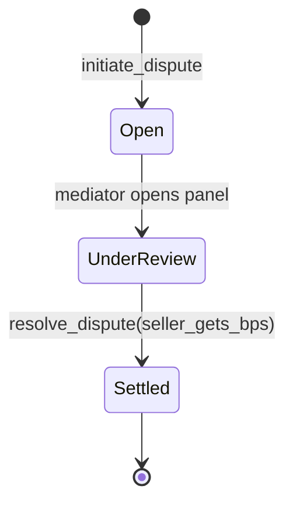

# Mediator Resolution Panel - Phase 3 Proof

Date: 2026-03-28
Route: `/mediator/disputes/[id]`

## Implemented semantic fixes

1. Contract call switched from `initiate_dispute` to `resolve_dispute`.
2. Resolution call now uses contract signature:
   - `resolve_dispute(trade_id: u64, mediator: Address, seller_gets_bps: u32)`
3. Loss-ratio action mapping:
   - `Resolve 50/50 On-Chain` => `seller_gets_bps = 5000`
   - `Resolve 70/30 On-Chain` => `seller_gets_bps = 7000`
4. Guard added to ensure URL id is numeric and valid for on-chain `trade_id`.
5. Mediator gating remains strict via Freighter identity + wallet whitelist.

## Proof-of-Delivery (PoD) & Dispute architecture

This section documents the end-to-end PoD flow: video upload, IPFS pinning,
driver attestation, and mediator settlement, plus the dispute lifecycle.

### End-to-end sequence



### IPFS pinning & gateway fallback

- Video is pinned through Pinata; the returned CID is stored on-chain via
  `submit_pod` so the attestation is immutable.
- The UI renders the video from the Pinata gateway and exposes a gateway
  fallback/switch action if the primary gateway is unavailable.
- The CID (not the raw video) is the canonical reference used by buyers and
  mediators during review.

### Driver attestation

- The driver wallet signs the `submit_pod` transaction, binding the CID to the
  driver identity and `trade_id`.
- Attestation is only accepted while the trade is in an `InTransit` state.

## State lifecycle guide

### PoD / trade states



| State | Meaning | Allowed transitions |
| --- | --- | --- |
| `Created` | Trade opened, awaiting driver | `InTransit` |
| `InTransit` | Driver en route; PoD not yet submitted | `Delivered` |
| `Delivered` | PoD video pinned and attested on-chain | `Completed`, `Disputed` |
| `Disputed` | Buyer raised a dispute; awaiting mediator | `Resolved` |
| `Completed` | Buyer confirmed delivery; funds released | terminal |
| `Resolved` | Mediator settled via `seller_gets_bps` split | terminal |

### Dispute resolution states



- `seller_gets_bps` encodes the split: `5000` = 50/50, `7000` = 70/30.
- Resolution is terminal; the contract releases funds according to the bps split.

## Pipeline / command evidence

Run from `frontend/`:

```powershell
npx eslint "src/app/mediator/disputes/**/*.{ts,tsx}"
```

Result:

- Pass (no lint output for mediator disputes files).

```powershell
npx tsc --noEmit
```

Result:

- Fails due to pre-existing unrelated files, not mediator page changes.
- Current errors:
  - `src/app/dev-test/page.tsx` (missing `Spinner`, `LoadingState` symbols)
  - `src/components/ui/FormField.tsx` (React `cloneElement` typing mismatch)

## Screenshot checklist (attach to PR)

1. Mediator wallet connected and authorized badge visible.
2. Unauthorized wallet state showing access blocked.
3. Video panel rendering with Pinata gateway label.
4. Click `Resolve 50/50 On-Chain` and show transaction hash status text.
5. Optional: gateway fallback/switch action visible.

## Notes for reviewers

- Full repo typecheck is currently red for unrelated pre-existing issues.
- Mediator resolution path itself is wired to the correct on-chain method and argument semantics.
