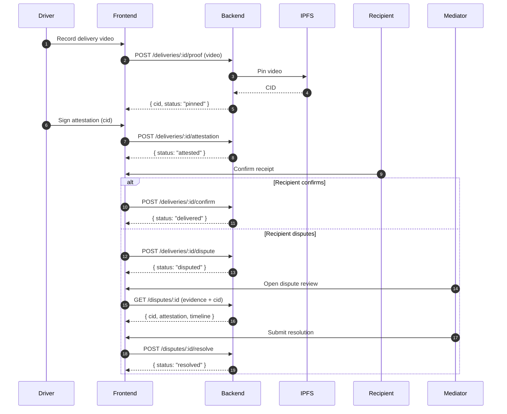
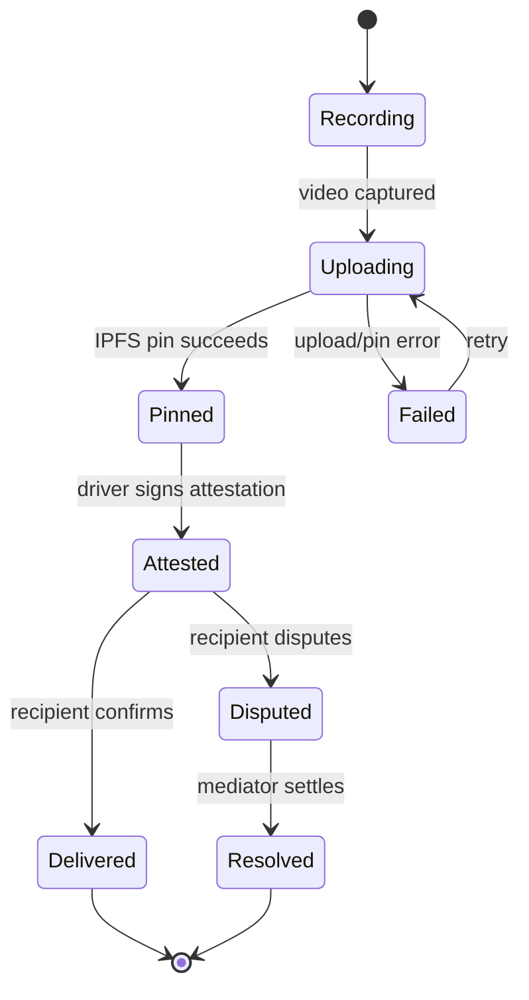

# Frontend Architecture

This guide explains how data flows through the frontend: the zustand stores that
hold state, the API client that talks to the backend, and the error contract that
turns failures into user-facing messages. It is meant to let a new developer
trace a request end-to-end without reading every source file.

## Data flow at a glance

```
UI component
  -> store action (zustand)
    -> api client (requestWithResult)
      -> backend
    <- Result<T> (ok | error)
  <- store updates state / surfaces error
UI renders state, and errorHandler maps errors to messages
```

## Stores (`frontend/src/stores/**`)

State is managed with [zustand](https://github.com/pmndrs/zustand). Each store
owns a slice of application state and exposes actions that mutate it. Stores
should not call the API directly from components; components call store actions,
and store actions call the API client.

| Store | Purpose |
| --- | --- |
| `authStore` | Holds the authenticated user/session and auth actions (login, logout, session refresh). Source of truth for "who is logged in". |
| `projectStore` | Holds the list of projects and the currently selected project, plus CRUD actions. |
| `taskStore` | Holds tasks for the active project and task CRUD/status actions. |
| `uiStore` | Ephemeral UI state: modals, sidebars, toasts, loading flags that are not tied to a domain entity. |
| `settingsStore` | User/app preferences (theme, notifications, etc.) and their persistence. |

> **Note:** Some stores may be unused/dead. Before adding a new store, check
> whether an existing one already owns that state. If a store has no importers
> outside its own file, treat it as dead and prefer extending an existing store
> rather than reviving it.

### Store conventions

- One store per domain concern; keep actions close to the state they mutate.
- Actions that hit the network should go through the API client and handle the
  `Result` returned by `requestWithResult` (see below).
- Keep derived data out of the store; compute it in selectors/components.

## API client (`frontend/src/lib/api/client.ts`)

The API client is the single entry point for backend calls. It wraps `fetch`,
attaches auth headers, and normalizes both success and failure into a predictable
shape.

### `ApiError`

`ApiError` is the error type thrown/returned by the client. It carries the HTTP
status, a machine-readable code, and a human-readable message so callers can
branch on the code while still showing something useful to the user.

```ts
class ApiError extends Error {
  status: number;   // HTTP status code
  code: string;     // machine-readable error code
  // message: string (from Error)
}
```

### `requestWithResult`

`requestWithResult` performs a request and returns a discriminated `Result`
instead of throwing, so callers can handle failures explicitly:

```ts
const result = await requestWithResult<Project[]>({ path: '/projects' });

if (result.ok) {
  // result.data is Project[]
} else {
  // result.error is an ApiError
}
```

- On success it returns `{ ok: true, data }`.
- On failure it returns `{ ok: false, error: ApiError }`.
- Prefer `requestWithResult` in store actions so errors are handled at the
  boundary rather than bubbling up as unhandled rejections.

## Error contract (`frontend/src/lib/errorHandler.ts`)

`errorHandler.ts` maps errors to user-facing messages. It is the single place
that decides what a user sees when something fails, so error copy stays
consistent across the app.

- It accepts an `ApiError` (or unknown error) and returns a display message.
- Mapping is keyed off the error `code`/`status`, with a generic fallback for
  anything unrecognized.
- UI code should call the handler rather than hard-coding error strings, so new
  error codes only need to be added in one place.

### Putting it together

1. A component calls a store action.
2. The action calls `requestWithResult`.
3. On failure it receives an `ApiError` and passes it to `errorHandler`.
4. The resulting message is stored in `uiStore` (e.g. a toast) and rendered.

## Proof-of-Delivery (PoD) & Dispute flow

This section documents the end-to-end Proof-of-Delivery lifecycle: the driver
uploads a delivery video, the backend pins it to IPFS, the driver attests to the
delivery, and — if the recipient disputes it — a mediator settles the dispute.
See `frontend/MEDIATOR_RESOLUTION_PROOF.md` for the mediator-facing resolution
proof details.

### Actors

| Actor | Role |
| --- | --- |
| Driver | Records/uploads the delivery video and signs the attestation. |
| Recipient | Confirms receipt or opens a dispute. |
| Backend | Validates uploads, pins to IPFS, stores the CID and attestation. |
| IPFS | Content-addressed storage for the delivery video (referenced by CID). |
| Mediator | Reviews evidence and settles an open dispute. |

### End-to-end sequence



### State lifecycle

A delivery moves through the following states. Each transition is triggered by
the action shown; invalid transitions are rejected by the backend and surfaced
through `errorHandler`.



| State | Meaning | Allowed next states |
| --- | --- | --- |
| `Recording` | Driver is capturing the delivery video. | `Uploading` |
| `Uploading` | Video is being uploaded and pinned to IPFS. | `Pinned`, `Failed` |
| `Failed` | Upload or pin failed; retryable. | `Uploading` |
| `Pinned` | Video stored on IPFS; CID recorded. | `Attested` |
| `Attested` | Driver signed the attestation over the CID. | `Delivered`, `Disputed` |
| `Delivered` | Recipient confirmed receipt. Terminal. | — |
| `Disputed` | Recipient opened a dispute. | `Resolved` |
| `Resolved` | Mediator settled the dispute. Terminal. | — |

### Dispute resolution notes

- Evidence for a dispute is the pinned video CID plus the driver attestation;
  the mediator UI fetches both via `GET /disputes/:id`.
- Resolution is final: once `Resolved`, the delivery cannot transition again.
- All network calls follow the store → `requestWithResult` → `errorHandler`
  pattern described above, so failures render consistent messages.
